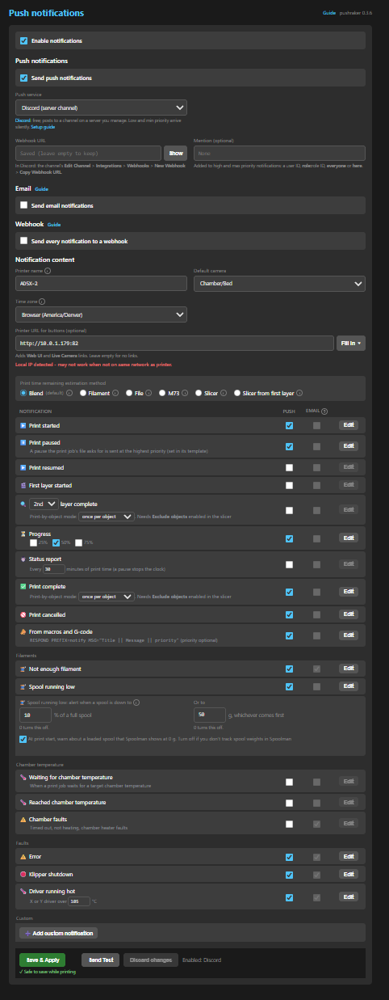
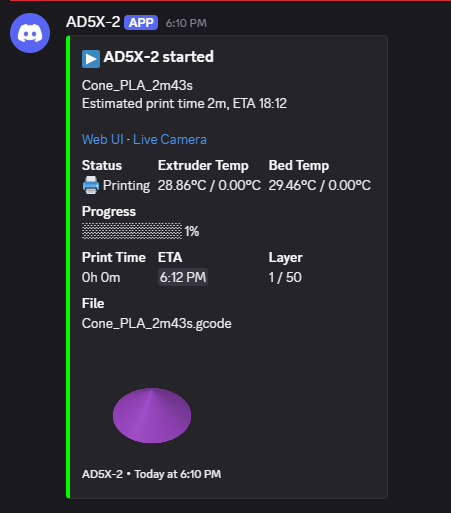
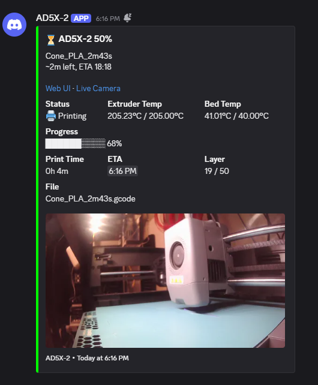
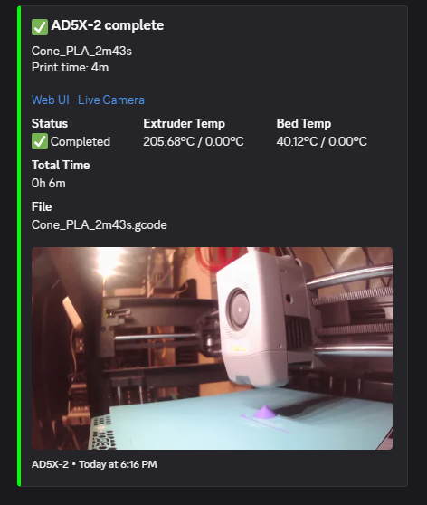

# diehard-pushraker

[pushraker](https://github.com/noon92/pushraker) push notifications, with
DIEHARDave's add-ons, as one plugin for three printer systems:

- **Kiln OS** (FlashForge AD5X), as a Kiln plugin
- **Zmod** (FlashForge AD5X, Creator 5), as a Zmod plugin
- **FLSUN T1 Pro** with [FLSUN_moonraker](https://github.com/DIEHARDave/FLSUN_moonraker), through [FLSUN_Updater](https://github.com/DIEHARDave/FLSUN_Updater)

pushraker sends a notification when a print starts, pauses, resumes,
completes or is cancelled, at progress steps and the first layer, and on
faults and shutdowns. Notifications can carry a camera snapshot, the model
preview or a spool picture, and can go to ntfy, Pushover, Gotify, Telegram,
Discord, a webhook or e-mail (through [Apprise](https://github.com/caronc/apprise)).
You set it all up on its own web page, and changes apply at once with no
restart. The [pushraker guide](https://github.com/noon92/pushraker/blob/main/docs/guide.md)
covers the settings.

The add-ons:

- **[Discord cards](#discord-cards)**: Discord messages laid out as status cards.
- **[Update notices](#update-notices)**: a daily check for software updates,
  posted to Discord with an Update button per entry.
- **The version line** at the top of the settings page:
  *Guide · pushraker 0.3.6 - with DIEHARDave's plugins 0.1.0*. It tells you
  whether pushraker itself or the add-ons changed.

The plugin ships pushraker and the pure-Python packages it needs in
`python/` (`tools/vendor.py`), so it's the same pushraker on every printer
and nothing is installed with pip. Where Moonraker's Python already has a
package (Apprise, Pillow and Jinja2 on Zmod and the T1), that copy is used.

<p align="center">
  
</p>

## Discord cards

A Discord message gets status card fields under pushraker's title and
text:

- Status, Extruder Temp and Bed Temp, side by side.
- During a print: a progress bar, then Print Time, ETA (shown in each
  reader's own time zone) and Layer, then File.
- When a print ends: ✅ Completed or 🚫 Cancelled, with Total Time and File.
- The printer's name and the time it was sent, in the footer.

The color follows the printer: green while printing or complete, orange
when paused, blue when ready. pushraker's error and failure notifications
stay red. The camera snapshot stays inside the card, below the fields.

`moonraker/components/pushraker_cards.py` does this without changing
pushraker's files. If a pushraker release changes what it hooks into,
pushraker's plain Discord message goes out instead. To turn the cards off,
set `discord_cards: False` under `[pushraker_cards]` and restart Moonraker.

<p align="center">
  
  
  
</p>

## Update notices

Once a day (or on your own schedule), the printer asks Moonraker's update
manager for updates and posts one Discord card that lists everything with
a newer version: Klipper, Moonraker, Fluidd/Mainsail, plugins and the OS
(Kiln OS, Zmod). Each entry has its own **Update** button beside it, inside
the card. At the bottom, **Open &lt;printer&gt; in browser** links to the
printer's web UI. There is no remote "update all" on purpose: one entry
per click.

- **With a Discord bot** (pushraker's *Discord DM* setting, or a
  `bot_token` of its own): the buttons are real. A click asks you to
  confirm, then the printer runs the update and edits the card with the
  result and what is still left. Discord delivers the click over the bot's
  Gateway, a connection the printer opens to Discord, so it works from
  anywhere and no port needs forwarding. Only you (the DM's recipient or the
  bot's owner) and `allowed_users` can click. Anyone else gets a private
  "not allowed" reply.
- **With a channel webhook** (pushraker's *Discord* setting): Discord
  doesn't let webhooks receive clicks, so the buttons are links to a
  confirm page on the printer (`/pushraker-updates/`). They work at home or
  over a VPN.

Updates are refused while printing. When Moonraker (or the OS) updates
itself it restarts, and the card gets the result once it's back. An entry
with local changes is listed with a warning instead of a button.

The settings are under `[pushraker_updates]` (in the plugin's Moonraker
config, see [What it changes](#what-it-changes)):

- `check_time`: one or more `HH:MM`.
- `check_days`: `daily`, `weekdays`, or days such as `mon, thu`.
- `timezone`: by default pushraker's time zone setting, else the printer's.
- `notify`: `changes` (only when something new shows up) or `always`.
- `ignore`, `confirm`, `allowed_users`, `web_ui_url`.
- `bot_token` + `channel` (optional): real buttons in a server channel.

To check now: the console macro `PUSHRAKER_CHECK_UPDATES` (Kiln, Zmod), or
`curl -X POST http://localhost:7125/server/pushraker_updates/check`.

## Install

Turn off whatever else sends print notifications first (kiln-notify,
Zmod's notify, FLSUN_notify), and the older plugins this one replaces
(see [Moving from the old plugins](#moving-from-the-old-plugins)).

### Kiln OS

Requires Kiln OS with plugin API 1.6 or later (v1.0.0). Over SSH as root
(Kiln's default password is `root`):

```sh
cd /data/ad5x/plugins
su klipper -s /bin/sh -c 'git clone https://github.com/DIEHARDave/diehard-pushraker.git'
```

Then in the console (Fluidd, Mainsail or HelixScreen):

```
ENABLE_PLUGIN NAME=diehard-pushraker ROOT=1
```

`ROOT=1` lets the plugin's root script add an nginx server on port 82 for
the settings page (Kiln's port 80 server is in the read-only image).

### Zmod

1. Add this to `mod_data/user.moonraker.conf`:

   ```ini
   [update_manager diehard-pushraker]
   type: git_repo
   channel: stable
   path: /root/printer_data/config/mod_data/plugins/diehard-pushraker
   origin: https://github.com/DIEHARDave/diehard-pushraker.git
   is_system_service: False
   primary_branch: main
   ```

2. In the console:

   ```
   ENABLE_PLUGIN name=diehard-pushraker
   ```

   The printer reboots.

### FLSUN T1 Pro

Needs [FLSUN_moonraker](https://github.com/DIEHARDave/FLSUN_moonraker):
pushraker needs Python 3.9 or newer, and FLSun's own Moonraker runs on 3.7.

Through [FLSUN_Updater](https://github.com/DIEHARDave/FLSUN_Updater): set
`diehard-pushraker: yes` in `flsun_plugins.cfg`. By hand, as `pi` (the
default password is `1`):

```sh
cd ~
git clone https://github.com/DIEHARDave/diehard-pushraker.git
~/diehard-pushraker/install.sh
```

### Then

Open the settings page, add where the notifications should go, choose
which events you want, and Save & Apply. Notifications are off until you
do.

- Kiln OS and Zmod: **http://&lt;printer&gt;:82/notifications/**
- FLSUN T1: **http://&lt;printer&gt;/notifications/** (also on Fluidd's port 81)

## What it changes

**Kiln OS** (`plugin.json`, `plugin.cfg`, `moonraker.conf`, `root/`):

- **Moonraker:** Kiln loads the components in `moonraker/components` and
  the plugin's `moonraker.conf` (`[pushraker]`, `[pushraker_cards]`,
  `[pushraker_updates]`, the update entry).
- **Klipper:** pushraker's macros, plus `[pushraker_hooks]`
  (`extras/pushraker_hooks.py`), which makes Kiln's `PRINT_END` and
  `CANCEL_PRINT` run `_PRINT_END_NTFY` / `_CANCEL_PRINT_NTFY` first. The
  print-end and cancel snapshots are then taken before the toolhead parks.
  Kiln's files are not touched.
- **nginx (root):** `/data/ad5x/nginx/diehard-pushraker.conf`, a server on
  port 82 with the settings page, the update confirm page and the Moonraker
  API they use. `DISABLE_PLUGIN NAME=diehard-pushraker` removes it.

**Zmod** (`diehard-pushraker.cfg`, `diehard-pushraker.moonraker.conf`,
`platform/zmod/`):

- **Moonraker** (in Zmod's chroot): links the components into Moonraker's
  `components` and includes `diehard-pushraker.moonraker.conf` from
  `mod_data/plugins.moonraker.conf`.
- **Klipper:** pushraker's macros, and the print-end and cancel snapshots
  taken before the toolhead parks:
  - Zmod's `END_PRINT` starts with `_NOTIFY TYPE=end`, an empty hook that
    Zmod's notify plugin fills. This plugin fills it with pushraker's
    print-end hook instead (so it can't run next to notify).
  - Zmod's `CANCEL_PRINT` has no such hook: `[pushraker_hooks]` (linked
    into Klipper's extras) runs pushraker's cancel hook at its start, once
    per cancel (Zmod passes a cancel to the native screen, which sends it
    back).
- **Settings page:** a second nginx on port 82, built from Zmod's own nginx
  template (as [zmod_dualweb](https://github.com/DIEHARDave/zmod_dualweb)
  does for port 81), started at every Klipper start. `PUSHRAKER_WEB` shows
  whether it runs, `PUSHRAKER_WEB STOP=1` stops it.

`DISABLE_PLUGIN name=diehard-pushraker` takes it all out again.

**FLSUN T1 Pro** (`platform/flsun/`):

- **Moonraker:** pushraker's installer (run from `python/`) adds its
  component shim and `[pushraker]` to `moonraker.conf`. The card and update
  components are linked in, and `~/printer_data/config/diehard-pushraker.conf`
  (included from `moonraker.conf`) holds `[pushraker_cards]`,
  `[pushraker_updates]` and the update entry.
- **Klipper:** pushraker's macros in `pushraker.cfg`, included from
  `printer.cfg`. `PRINT_END` in [FLSUN_Macros](https://github.com/DIEHARDave/FLSUN_Macros),
  and `END_PRINT` and `CANCEL_PRINT` in [FLSUN_klipper](https://github.com/DIEHARDave/FLSUN_klipper),
  call pushraker's hooks before the nozzle parks.
- **nginx:** `/notifications/` and `/pushraker-updates/` in Mainsail's
  (port 80) and Fluidd's (port 81) sites.
- **The `diehard-pushraker` service** runs `platform/flsun/sync.sh` at boot
  and after each update: it wires in what changed and restarts only that
  (Klipper only when no print is running). `journalctl -u diehard-pushraker`
  shows what the last sync did.

On every printer, the notification settings are in
`printer_data/config/pushraker.conf`, and tokens and passwords in
`printer_data/pushraker.secrets` (outside the config folder, never served).
Uninstalling keeps both, so a reinstall picks them up again.

## Updates

Fluidd or Mainsail, Software Updates: **diehard-pushraker**. Kiln OS:
`RESTART` Klipper after an update. Zmod: reboot. FLSUN T1: the service
syncs by itself.

## Moving from the old plugins

This plugin replaces pushraker-kiln, zmod_pushraker and FLSUN_pushraker
(archived). Turn the old one off first. The notification settings stay
where they are, so the new plugin picks them up:

- Kiln OS: `DISABLE_PLUGIN NAME=pushraker`
- Zmod: `DISABLE_PLUGIN name=zmod_pushraker`, then remove its
  `[update_manager zmod_pushraker]` from `user.moonraker.conf`
- FLSUN T1: `flsun_pushraker: no` in `flsun_plugins.cfg` (or
  `~/FLSUN_pushraker/uninstall.sh`)

## For maintainers

- `python tools/vendor.py [version]` refills `python/` from PyPI (any OS
  with pip): py3-none-any wheels only, PyYAML built without its C
  extension, then applies the fixes listed in `PATCHES`: a settings page
  fix for printers without the U1's filament change row (sent upstream),
  and the add-on version line.
- New pushraker releases are picked up by a daily check
  (`.github/workflows/pushraker-release.yml`). It opens a pull request
  that re-vendors `python/` and reports the page fix and test results.
  Try it on a printer before merging (the PR says how), then bump
  `plugin.json` and tag.
- `tests/`: offline checks, one file per printer system plus the update
  notices (`pip install apprise requests jinja2 pillow tornado`).
- The first Moonraker start after an install or update compiles the
  package on the printer and takes about 25 s longer. A Kiln plugin using
  AFC can time out waiting for Moonraker during that start: run
  `FIRMWARE_RESTART` if PREP fails.

## License

GPLv3, as pushraker. See [LICENSE](LICENSE).
